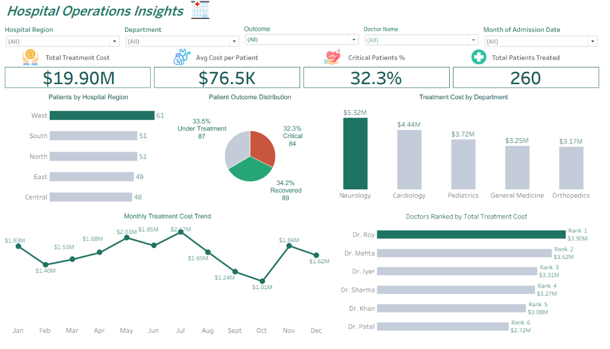
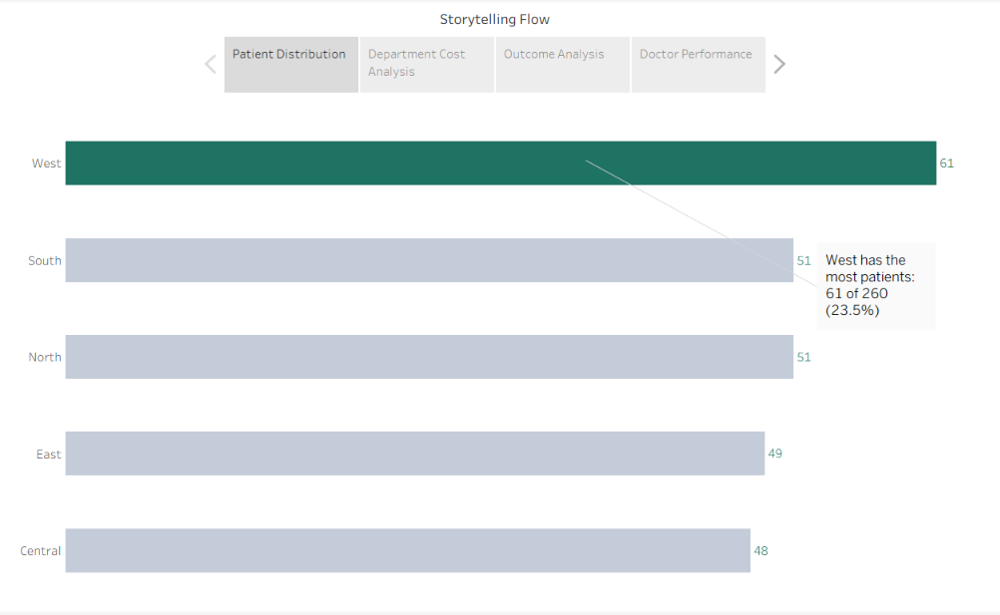
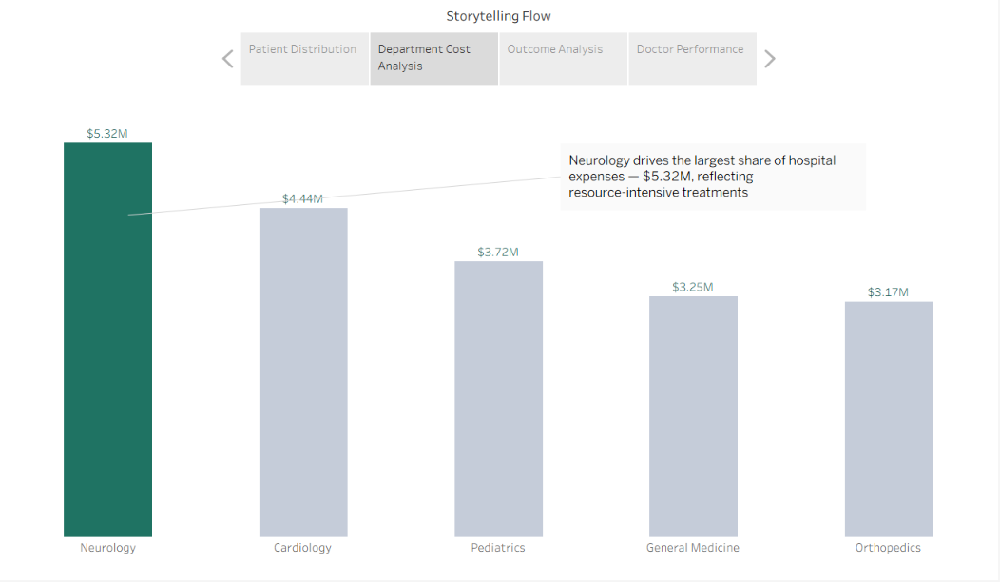
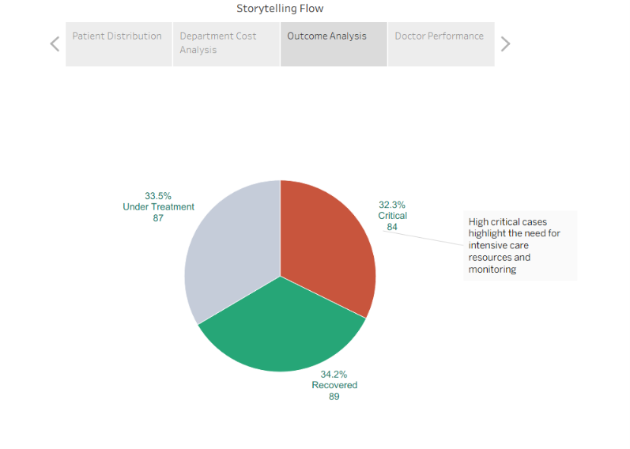
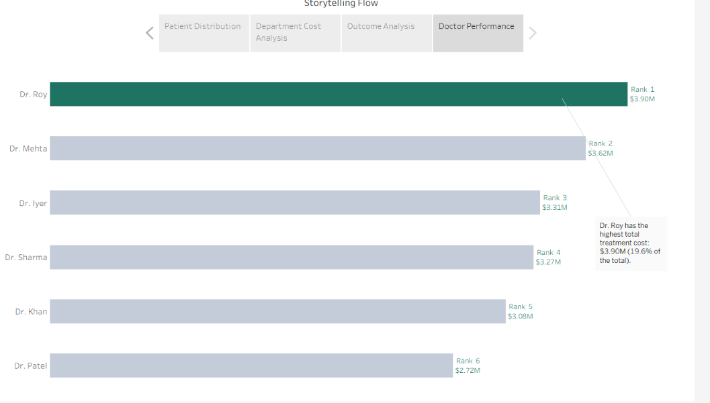

# Hospital Management Analytics

An interactive Tableau dashboard and a four-point story covering patient distribution, department treatment cost, patient outcomes, and doctor performance.

## Business objective

Help hospital management review patterns in patient volume, treatment costs, and recorded outcomes. The dashboard supports exploration of the available data; its charts describe patterns and do not establish their causes.

## Dashboard

[View the live dashboard on Tableau Public](https://public.tableau.com/app/profile/md.ziaul.haque2813/viz/Hospital_Management_Tableau_Dashboard/InteractiveDashboard)

The dashboard brings together:

- Patients by hospital region
- Treatment cost by department
- Patient outcome distribution
- Monthly treatment cost trend
- Doctors ranked by total treatment cost
- KPI cards for total treatment cost, average cost per patient, critical patient percentage, and total patients treated

Filters shown in the dashboard include hospital region, department, outcome, doctor name, and month of admission date.

## Story

The Tableau story presents four views.

### 1. Patient Distribution

West has the most patients (61 of 260). South and North follow with 51 each, then East (49) and Central (48).

### 2. Department Cost Analysis

Neurology has the highest treatment cost at $5.32M, followed by Cardiology ($4.44M), Pediatrics ($3.72M), General Medicine ($3.25M), and Orthopedics ($3.17M).

### 3. Outcome Analysis

Outcomes are split almost evenly: 89 Recovered (34.2%), 87 Under Treatment (33.5%), and 84 Critical (32.3%).

### 4. Doctor Performance

Dr. Roy has the highest total treatment cost at $3.90M, followed by Dr. Mehta ($3.62M), Dr. Iyer ($3.31M), Dr. Sharma ($3.27M), Dr. Khan ($3.08M), and Dr. Patel ($2.72M).

## Findings

Based on the project dataset and the displayed dashboard:

- **260** patients were treated.
- Total treatment cost was approximately **$19.90M**.
- **West** had the largest patient count, with **61**.
- **Neurology** had the highest department treatment cost, at **$5.32M**.
- **July** had the highest displayed monthly treatment cost, at **$2.17M**; **October** had the lowest, at **$1.01M**.
- Outcomes were **89 Recovered (34.2%)**, **87 Under Treatment (33.5%)**, and **84 Critical (32.3%)**.
- **Dr. Roy** had the highest displayed doctor treatment cost, at **$3.90M**.
- South and West tied for the most Critical patients, with 20 each (calculated from the dataset).

Values are rounded as displayed in the dashboard.

## Project files

- `Dataset/` - the hospital dataset (260 patient records)
- `Hospital_Management_Tableau_Project.twbx` - Tableau packaged workbook with the dashboard and story
- `Hospital_Management_Tableau_Project_Brief.docx` - project brief with the business objective and questions
- `Screenshots/` - dashboard and story point screenshots

## Data and privacy
The dataset in Dataset/ is a sample hospital dataset (260 records). It contains patient IDs but no names or contact details.

## Interpretation

Treatment cost alone does not measure care quality, patient complexity, or department efficiency. Patient counts alone do not establish staffing needs, capacity, or unmet demand. Use the findings as descriptive signals for further review alongside appropriate operational context.

## Tools

- Tableau
- CSV dataset
- GitHub
